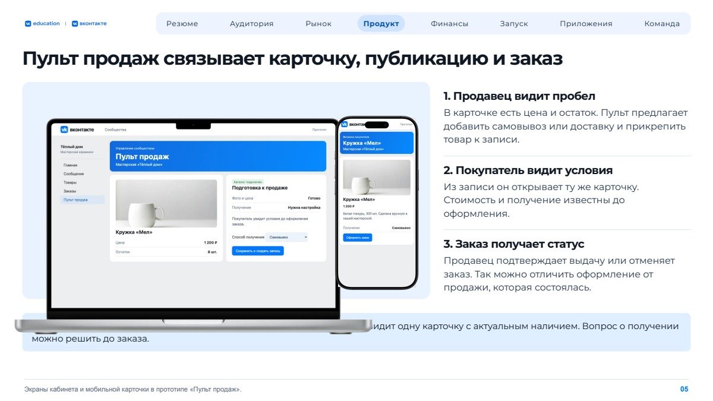

# Пульт продаж


**VK Case Champ 2026 · Москва · Стратегия на основе аналитики**

Предлагаем добавить в кабинет бизнес-сообщества подсказку о следующем действии. Если товар уже опубликован, но покупателю неясно, как его получить, продавец увидит конкретный шаг: указать самовывоз, прикрепить карточку к записи и отследить заказ до выдачи.

**[Скачать конкурсный PDF](presentation/Digital%20Cat%24_strategy_msk.pdf)** · [Стратегия и обоснование](docs/STRATEGY.md) · [Ответы экспертов с таймкодами](docs/CONSULTATION.md)

## Почему начинаем с этих магазинов

В сентябрьской выборке среди бизнесов с активным каталогом 91,9% подключили чекаут, а заказы получили 7,2%. Пилот предлагаем для продавцов с активным ассортиментом, просмотрами товарного контента и аудиторией свыше 1 тыс. до 100 тыс. подписчиков. Из 493 подходящих бизнесов заказы получили 121. Наличие аудитории и каталога позволяет проверять препятствия между публикацией и заказом.



## Что увидит жюри

| Страницы PDF | Содержание |
|---|---|
| 1–4 | Название кейса, резюме, сегмент и позиция VK среди каналов продаж |
| 5–6 | Макеты кабинета и покупки, путь продавца, роль Маркета |
| 7–8 | Денежный поток, сценарии, этапы пилота и решение о масштабировании |
| 9–17 | Источники, проверка данных, концентрация, гипотезы, дерево причин, альтернативы и каналы продаж |
| 18–22 | Предпосылки экономики, расчёт эксперимента, риски, источники и QR-коды |
| 23–28 | Консультация, инфраструктура, процесс заказа, размер теста, товарные категории и эффекты инструментов |
| 29 | Команда Digital Cat$ |

## Метрики и экономика

После консультации приоритет у дополнительных оформленных заказов через бизнес-сообщества. Сравниваем число заказов на назначенный бизнес между тестом и контролем, включая нулевые наблюдения. Доля продавцов с заказом показывает широту эффекта. Для её целевого прироста на 5 п.п. предварительно нужны 2 476 бизнесов. Для роста числа заказов на 20% требуется ориентировочно 9 334 бизнеса на группу. Историческая база: 1 869 заказов у 493 бизнесов, среднее 3,79, стандартное отклонение 18,49.

Базовый сценарий предполагает 4,8 млн ₽ вложений, 6 000 активных бизнесов и выход на масштаб за полгода. При таких допущениях модель даёт 410 тыс. ₽ операционного результата в месяц на масштабе и возврат инвестиций на 17-м месяце. [Предпосылки и помесячный денежный поток](analysis/scenarios.json).

## Посмотреть демонстрацию

После скачивания репозитория откройте [demo/index.html](demo/index.html) в браузере. Выберите способ получения, опубликуйте товар, оформите заказ и отметьте выдачу или отмену. [HTML презентации](presentation/index.html) также открывается локально. Вкладки в верхнем меню ведут к разделам.

## Повторить расчёты и собрать PDF

Из корня репозитория выполните команды ниже. Для анализа выборки и пилота нужен исходный XLSX организаторов. Замените значение WORKBOOK на путь к книге. Готовые результаты находятся в [analysis](analysis), поэтому для сборки PDF пересчёт книги необязателен.

```sh
python3 -m venv .venv
. .venv/bin/activate
python -m pip install pandas openpyxl
WORKBOOK="/путь/к/датасету.xlsx"
python analysis/audit_dataset.py "$WORKBOOK"
python analysis/analyze_market.py "$WORKBOOK"
python analysis/pilot.py "$WORKBOOK"
python analysis/build_scenarios.py
python analysis/export_tables.py
python presentation/build_deck.py
cd presentation
npm install
npx playwright install chromium
npm run render
```

## Материалы проекта

[Критерии отбора](docs/REQUIREMENTS.md) · [Проверка данных](analysis/dataset_audit.json) · [Расчёты по рынку](analysis/market_analysis.json) · [Разбор референсов и восьми публичных репозиториев](docs/REFERENCES.md)

Фирменная графика VK Education и ВКонтакте взята из задания чемпионата. Кадр на странице 23 взят из консультации около 10:00. Макеты интерфейса иллюстрируют предложение команды.

**Digital Cat$** · Егор Чуланов, Екатерина Макаренко, Максим Ширяев, Анфиса Опарина.

[Скачать таблицы Excel](analysis/VK-Cases.xlsx) · [Проверка решения по критериям](docs/REQUIREMENTS.md) · [Материалы интерфейса и макетов](docs/DESIGN.md)
