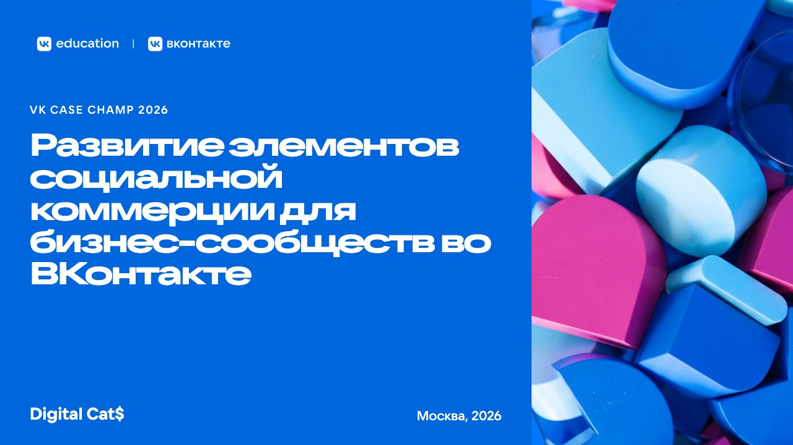

# Товар в записи

Стратегия социальной коммерции для бизнес-сообществ ВКонтакте. VK Case Champ 2026, Москва. Команда Digital Cat$.



[Презентация, PDF](presentation/Digital%20Cat%24_strategy_msk.pdf) · [Расчёты, Excel](analysis/VK-Cases.xlsx) · [Запуск магазина](demo/README.md)

## Что меняется для магазина

В выбранном сегменте 493 сообщества уже публикуют товарный контент. В сентябре 121 из них получил заказ. Предлагаем дать продавцу редактор товара с проверкой получения, привязать карточку к записи, затем показать оформленный заказ и его исход. Покупатель может сохранить товар и вернуться к нему в Маркете.

Прототип позволяет пройти этот путь. В одном окне продавец публикует товар, в другом покупатель выбирает получение и оформляет заказ. У ролей общая база. Выдача появляется в истории у обеих сторон, отмена восстанавливает остаток.


## Как попробовать

Понадобятся Python 3.10+ и Node.js 22.12+. Запустите из папки проекта:

```bash
./demo/run.sh
```

[Открыть магазин на этом компьютере](http://127.0.0.1:8765). [Пошаговый маршрут для двух окон](demo/README.md).

## Чем обосновано решение

| Вопрос | Где смотреть |
|---|---|
| Почему начать с существующих сообществ | Слайды 2–4. Воронка отбора, доли открытий и сравнение сообществ внутри диапазонов подписчиков |
| Что именно изменится | Слайды 5–6 и 11. Экраны работающего прототипа, карта пути, роли и логика заказа |
| Какие альтернативы рассматривали | Слайд 10. Привлечение продавцов, главная Маркета, авторы, проверка товара и скидки |
| Сколько потребуется денег | Слайды 7 и 12. Вложения 4,8 млн ₽. При 6 000 активных продавцов базовый сценарий даёт 410 тыс. ₽ потока в месяц и возврат вложений на 17-м месяце |
| Что можно доказать | Слайд 13. На 50–100 сообществах проверяем путь покупки. Для проверки роста заказов на 20% ориентир составляет 9 334 бизнеса на группу |

В Excel можно изменить допущения и увидеть их влияние на денежный поток. На с. 9 PDF разобраны расхождения исходных агрегатов. [Пять вопросов кейса и критерии](docs/REQUIREMENTS.md) · [Что уточнили эксперты](docs/CONSULTATION.md) · [Источники оформления](docs/DESIGN.md)

## Как повторить расчёты

Нужна исходная книга VK Case Champ с семью листами. Денежные сценарии строятся отдельно из плановых предположений.

```bash
python3 -m venv .venv
source .venv/bin/activate
python -m pip install pandas openpyxl xlsxwriter
WORKBOOK="/путь/к/исходному.xlsx"
python analysis/audit_dataset.py "$WORKBOOK"
python analysis/analyze_market.py "$WORKBOOK"
python analysis/pilot.py "$WORKBOOK"
python analysis/build_scenarios.py
python analysis/export_tables.py
python presentation/build_deck.py
cd presentation
npm install
npx playwright install chromium
npm run render
```

## Материалы

- [Сегменты, источники, категории и контрольные суммы](analysis/market_analysis.json)
- [Исходная дисперсия и чувствительность размера теста](analysis/pilot.json)
- [Допущения и денежные потоки](analysis/scenarios.json)
- [Конкурентные примеры и референсы](docs/REFERENCES.md)
- [Итог проверки версии](docs/STATUS.md)

Егор Чуланов, Екатерина Макаренко, Максим Ширяев, Анфиса Опарина.
