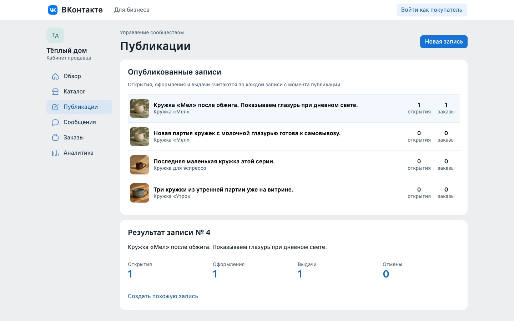

<p align="center"></p>
<h1 align="center">Магазин сообщества</h1>
<p align="center">Публикации, покупатели и заказы в кабинете продавца ВКонтакте.<br>Решение Digital Cat$ для VK Case Champ 2026, Москва.</p>
<p align="center">
  <a href="https://egorchulanov.github.io/vk-case-2026/"></a>
  <a href="https://egorchulanov.github.io/vk-case-2026/slides.pdf"></a>
  <a href="https://egorchulanov.github.io/vk-case-2026/journey.html"></a>
  <a href="https://egorchulanov.github.io/vk-case-2026/model.xlsx"></a>
</p>

Кейс «Развитие элементов социальной коммерции для бизнес-сообществ во ВКонтакте». В сентябре только 285 из 3 961 бизнесов с активным товаром получили заказ через оформление VK. Мы выбрали 493 сообщества, где каталог уже есть, товарный контент смотрят, а размер аудитории позволяет искать похожие магазины для пилота.

Продавец видит, каких условий не хватает карточке, публикует записи о товаре и разбирает покупки по источникам. Покупатель может уточнить получение прямо в заказе или вернуться к сохранённой вещи в Маркете.

<p align="center"></p>

## Кабинет продавца

| Раздел | Что можно сделать |
|---|---|
| Обзор | Открыть заказ, который ждёт выдачи, ответить на вопрос или закончить черновик. Счётчики ведут к соответствующим записям. |
| Каталог | Создать товар с фотографией, указать цену и остаток, настроить самовывоз или курьера, сохранить черновик и опубликовать карточку. |
| Публикации | Выпустить несколько записей с одним товаром. У каждой свои открытия, заказы, выдачи и отмены. |
| Сообщения | Найти вопросы без ответа. Из разговора перейти в заказ, проверить покупку и ответить. |
| Заказы | Найти заказ по номеру или товару, посмотреть источник, условия и историю. Отметить выдачу либо указать причину отмены. |
| Аналитика | Посмотреть оформления, выдачи и отмены. Из нужной точки входа открыть список заказов, которые дают итог. |



## Покупка

1. Покупатель открывает товар из конкретной записи в ленте. Источник сохраняется до оформления.
2. В карточке видны цена, количество и условия получения. Вещь можно сохранить в Маркете. Его фильтры учитывают бюджет и стоимость выбранной доставки.
3. При оформлении магазин проверяет цену и резервирует остаток. Номер заказа и условия появляются у обеих сторон.
4. Покупатель пишет вопрос в карточке заказа. Продавец отвечает, подтверждает выдачу или отменяет заказ. При отмене товар возвращается на витрину один раз.

Развилки пути и показатели каждого этапа собраны в [интерактивной карте](https://egorchulanov.github.io/vk-case-2026/journey.html).

## Откуда взялись цифры

| Показатель | Значение | Как читать |
|---|---:|---|
| Бизнесы в исходной выборке | 9 754 | Сентябрь 2026 года |
| Приоритетная группа | 493 | Активный товар, просмотры товарного контента, больше 1 тыс. и до 100 тыс. подписчиков |
| С заказом в группе | 121 | 24,5% выбранных бизнесов |
| Оформления в группе | 1 869 | 53,7% от 3 478 заказов выборки |
| Заказы на бизнес | 3,79 | Среднее по всем 493, включая нули |
| Цель эксперимента | +20% | При историческом разбросе требуется около 9 334 бизнесов на группу. Пилот на 50–100 магазинах нужен для проверки пути и событий |
| Возврат вложений в базовом сценарии | 17-й месяц | При 4,8 млн ₽ на запуск, 6 000 активных продавцов и +410 тыс. ₽ месячного потока после подключения |

Исходные агрегаты и коммерческие допущения лежат на разных листах. Даты выхода в плюс пересчитываются при изменении параметров. [Скачать книгу](https://egorchulanov.github.io/vk-case-2026/model.xlsx)

## Запуск магазина

Нужны Python 3.10+ и Node.js 22.12+. Запустите из корня проекта.

```bash
./demo/run.sh
```

Откройте [магазин на своём компьютере](http://127.0.0.1:8765). Для одновременной проверки войдите продавцом в обычном окне, покупателем в приватном. Прототип работает с локальной базой, роли учебные. Сообщения и заказы сохраняются после перезапуска. [Сценарии и проверки](demo/README.md)

## Устройство проекта

| Раздел | Содержимое |
|---|---|
| [Данные и расчёты](analysis/) | Проверка исходной книги, сегментация и каналы продаж, модель эксперимента, помесячная экономика, выгрузка в Excel |
| [Магазин](demo/) | Интерфейс VKUI, сервер FastAPI, реестр заказов и публикаций, тесты основного пути и исключений |
| [Презентация](presentation/) | Исходники, шрифты, снимки реального прототипа в устройствах, PDF и проверка границ слайдов |
| [Карта пути](docs/jury/journey.html) | Автономная HTML-версия для просмотра без подключения |
| [Проверка по заданию](docs/REQUIREMENTS.md) | Пять вопросов кейса, страницы с ответами и ограничения |
| [Консультация](docs/CONSULTATION.md) | Уточнения экспертов с таймкодами |
| [Разбор решений и источников](docs/REFERENCES.md) | Оригинальные продукты VK, практики других команд и ссылки на версии |


**На защите** Егор Чуланов представляет продукт и прототип, Екатерина Макаренко отвечает за исследование и путь покупателя, Максим Ширяев за данные и эксперимент, Анфиса Опарина за экономику и запуск.
